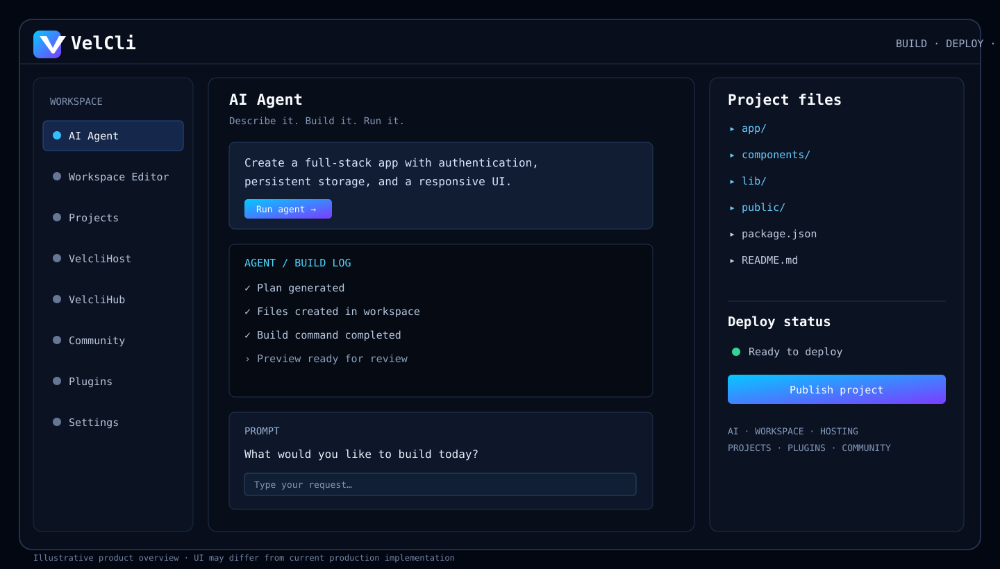

<div align="center">


# VelCli

### AI-powered development workspace · Build · Deploy · Scale

**Turn ideas into software with an AI agent, project workspace, and deployment workflow.**

[Live app](https://velcli.dev) · [Repository](https://github.com/Velclaw/VelCli) · [Report an issue](https://github.com/Velclaw/VelCli/issues)

</div>

---

## App overview



> The overview above is a branded illustrative mockup for product orientation. Exact features and availability depend on the current production build.

## What is VelCli?

VelCli is an early-stage AI-assisted engineering workspace for creating, inspecting, testing, and preparing web projects for deployment. It brings the agent conversation and project workspace into one developer-focused interface.

## Product areas

| Area | Purpose |
|---|---|
| **AI Agent** | Describe a task, plan implementation, and assist with code changes. |
| **Workspace Editor** | Browse project files and work with code and previews. |
| **Projects & history** | Keep track of project metadata and prior conversations where storage is configured. |
| **VelcliHost** | Product area for hosting and deployment workflows. |
| **VelcliHub** | Product area for templates and reusable project resources. |
| **Community** | Project for collaboration and community contributions. |
| **Plugins** | Extension and integration surface. |
| **Settings** | Configure available preferences and provider options. |

## Current implementation and limitations

VelCli is actively developed. Do not assume every product area is fully backed by production services.

- **AI provider:** configure `GEMINI_API_KEY` and `VELCLI_PROVIDER=gemini` in Render when using Gemini.
- **Admin access:** set a strong, unique `VELCLI_ADMIN_PASSWORD` in Render. Never commit the password or provider keys.
- **Database:** history and project metadata use PostgreSQL when `DATABASE_URL` is configured; otherwise the app may fall back to local JSON storage.
- **Persistence:** local files and workspace files on an ephemeral hosting filesystem can be lost on restart. Use PostgreSQL for supported structured data and a persistent disk or object storage for workspace files.
- **Sessions:** current sessions are in-memory and may expire on process restart. A shared administrator password is not multi-user authentication or role-based access control.
- **Execution safety:** restricted command allowlists are not a full OS/container sandbox. Do not run arbitrary untrusted workloads.
- **Preview/deployment:** static preview and project deployment capabilities have limitations; verify the specific workflow before relying on it in production.

## Deployment

Production site: **[https://velcli.dev](https://velcli.dev)**

Render service: [Open deployment dashboard](https://dashboard.render.com/web/srv-db40auqd0e5s73fbabog)

Typical build and start commands:

```bash
npm install
npm run build
npm run dev
```

Configure secrets through the Render service's **Environment** settings. Do not put secret values in this README, source code, screenshots, commit messages, chat history, or client-side storage.

### Environment variables

| Variable | Purpose |
|---|---|
| `VELCLI_ADMIN_PASSWORD` | Admin login secret; set in Render only. |
| `GEMINI_API_KEY` | Gemini provider key; set in Render only. |
| `VELCLI_PROVIDER` | Provider selection, for example `gemini`. |
| `DATABASE_URL` | PostgreSQL connection string; set in Render only. |

Only configure variables required by the deployed service. Never share their values publicly.

## Repository structure

```text
VelCli/
├── apps/       # Application code
├── assets/     # README brand and overview artwork
├── scripts/    # Development and validation scripts
└── README.md
```

## Development and validation

Before releasing a change:

1. Review the diff and avoid committing secrets.
2. Run the available build, type-check, and smoke-test scripts.
3. Confirm Render finishes deploying the intended commit.
4. Check the production health endpoint and key user flows.
5. Verify persistence by writing and reading back test data using the configured database.

A successful homepage response alone does not prove that login, database persistence, or deployment workflows are functioning correctly.

## Security

- Never commit API keys, passwords, OAuth secrets, or database URLs.
- Keep provider credentials in Render environment variables.
- Use a unique, strong admin password.
- Do not expose database access publicly unless strictly required.
- Treat untrusted generated code and terminal commands as potentially unsafe.

## Contributing

Issues and pull requests are welcome. Include reproduction steps, expected behavior, and relevant sanitized logs. Never include credentials or personal data in issue reports.

---

<div align="center">

**VelCli — Build · Deploy · Scale**

[velcli.dev](https://velcli.dev) · [GitHub issues](https://github.com/Velclaw/VelCli/issues)

</div>
